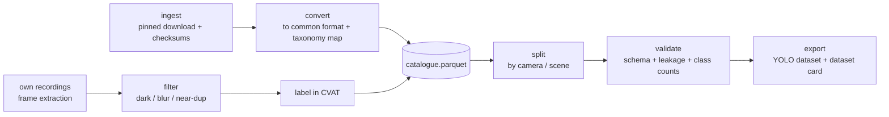

# Review R2: Data engineering

Status: **decided** (2026-11-02), see section 7. Decisions are copied into `technical_spec.md` (2.3, 3.3, T-018 to T-022) and `functional_spec.md` (section 3, D-009).

## 1. Verdict

The pipeline design (DVC stages, R2 storage, scene-level split) is sound. **The data itself is the weak point.** The project has no fixed-camera footage of Rabat, an unlabelled licence for the dataset it actually trained on, a labelling tool that would publish private street footage, and an imbalance fix based on arguments that no longer exist in Ultralytics.

There is also good news. A 2026 dataset, **BMD-45**, is a near-perfect public training base: fixed Safe-City CCTV cameras in a developing city, 14 vehicle classes including three-wheelers, released under CC BY 4.0.

## 2. Findings

| # | Finding | Severity | Evidence |
|---|---|---|---|
| F1 | **No fixed-camera Rabat data.** The Rabat footage is three drive-through YouTube videos: real Rabat streets, but filmed from a moving car at street level, while the product works on fixed, elevated cameras. | High | `notebooks/01`, `docs/legacy_results.md` |
| F2 | **The trained dataset's origin and licence are undocumented.** The Roboflow export `CCTV.v9` has 6,294 images and Indonesian source class names (remapped in notebook 01), so most images probably come from a third-party Roboflow Universe dataset. | High | notebook 01 remap, notebook 02 outputs |
| F3 | **83% of images are empty** (5,206 of 6,294), and 89.8% of boxes are `voiture`. Three classes have 7 to 12 boxes, too few to train or to evaluate reliably. | High | `docs/legacy_results.md` |
| F4 | **The imbalance plan used arguments that are gone.** Current Ultralytics has no `image_weights` or `fl_gamma`. It now has `cls_pw` (class-weight power: 0 = off, 1 = full inverse frequency). | Medium | `ultralytics/cfg/default.yaml` on `main`, fetched 2026-11-02 |
| F5 | **Roboflow's free plan makes projects public** on Roboflow Universe. Uploading own Rabat footage there would publish faces and plates. | High (privacy) | Tool comparisons, see sources; *verify on Roboflow pricing page* |
| F6 | **Licences are mixed and mostly non-commercial.** This affects what can be republished on Hugging Face, and under which licence. | Medium | Table in section 3 |
| F7 | **The R2 free tier (10 GB-month) can be exceeded** if public datasets are copied into the bucket. | Low | R2 pricing: 10 GB-month, 1 M Class A, 10 M Class B ops free, free egress; then $0.015/GB-month |
| F8 | **No data catalogue.** Nothing records per image its source, camera or scene, condition, licence, split or checksum, so splits and licences can't be audited. | Medium | repo |
| F9 | **No class taxonomy contract.** Each source names classes differently (`voiture`, `car`, `auto-rickshaw`…), and the mapping lived in a notebook cell. | Medium | notebook 01 |

## 3. Sources, checked

| Source | View | Size | Classes of note | Licence | Use in VBTSO |
|---|---|---|---|---|---|
| **BMD-45** (IISc, 2026), [HF `iisc-aim/BMD-45`](https://huggingface.co/datasets/iisc-aim/BMD-45) | **Fixed CCTV**, 3.6K Safe-City cameras, Bengaluru | 45K images, 480K boxes | 14 fine-grained classes, incl. auto-rickshaw, tempo traveller | **CC BY 4.0** (LICENSE file per paper; HF metadata blank, *verify file*) | **Core training base.** Closest public match: fixed cameras and mixed developing-city traffic. |
| **MoVITS** (Mendeley, Rabat), [DOI 10.17632/5jcg5vfx58](https://data.mendeley.com/datasets/5jcg5vfx58) | Recorded **in Rabat**, stereo vision system (*verify whether fixed or moving*) | *verify* | bus, truck, minivan, microbus, sedan, SUV; YOLO/VOC/COCO labels | CC BY-NC-SA 4.0 | **Rabat domain set**: fine-tuning and/or Rabat test. Non-commercial and share-alike: keep separate from CC BY releases. |
| **MIO-TCD** (Miovision) | Fixed traffic cameras, Canada/US | 786K images (classification + localisation) | 11 classes | CC BY-NC-SA 4.0 | Optional extra pretraining or robustness data. |
| **UA-DETRAC** | Fixed cameras, Beijing/Tianjin highways | 100 videos, 140K frames | car, bus, van, others (coarse) | **Not confirmed** (official site not retrieved) | Only for **tracking/counting evaluation** (P3), once the licence is confirmed. |
| **VisDrone** | Drone, aerial | – | – | CC BY-NC-SA 3.0 (from mirrors, *verify*) | **Drop.** Wrong viewpoint for a fixed street camera. |
| **BDD100K** | Dashcam | – | – | BSD-3-Clause (secondary sources, *verify*) | **Drop** for training (moving camera). |
| Current `CCTV.v9` Roboflow export | Mixed | 6,294 images | 8 classes | **Unknown** | Freeze as *legacy*. Use only after the origin and licence are found. |
| YouTube drive-through frames (Rabat) | Moving camera, street level | 1,329 kept frames, 3 videos (day, night, rain) | grand taxi, triporteur, tram | Third-party footage: training use is a grey area, redistribution not allowed | **Rabat fine-tuning and test**, split by video. Never published. |
| Own fixed-camera recording in Rabat | **Fixed**, the real target | to be recorded | grand taxi, triporteur, tram | Own; personal data rules apply | **The Rabat test set**, and the only source of `grand_taxi`. |

Taxonomy note: BMD-45's auto-rickshaw and Morocco's triporteur are both three-wheelers. A core class **`three_wheeler`** lets the model learn from thousands of BMD-45 boxes instead of 11 local ones. `grand_taxi` stays a local class (a car with a distinctive colour, learned on Rabat data).

## 4. Recommendations

### R2-1 Data strategy in three layers
1. **Base:** BMD-45 (CC BY 4.0), mapped to the VBTSO taxonomy, on top of COCO-pretrained YOLO weights.
2. **Domain:** Rabat data, in two parts: MoVITS (if its viewpoint is usable) and **own fixed-camera recordings**, the highest-value item in the whole project.
3. **Test:** a held-out Rabat video that is never trained on, and later a fixed-camera Rabat test set if one becomes available.

This turns the data problem from "too few images" into a **domain-adaptation story** (developing-city CCTV to Rabat). That story is measurable (experiment X6) and makes a much better portfolio narrative.

### R2-2 Don't copy public datasets into R2
The ingest stage downloads public datasets from their source **at a pinned revision** (for example a Hugging Face commit hash) and verifies checksums. Only own recordings, own labels and derived artefacts (the catalogue, the exported training set) go to R2. This keeps the bucket inside the free tier and avoids redistributing third-party data.

### R2-3 A data catalogue as the backbone
One Parquet table, `catalogue.parquet`, versioned with DVC, with one row per image and these columns: `image_id`, `sha256`, `source`, `source_revision`, `camera_id`/`scene_id`, `condition` (day/night/rain), `licence`, `split`, `n_boxes` per class. Splits, licence filtering, class statistics and the dataset card are all generated from it. This is the core data-engineering piece of the project.

### R2-4 Taxonomy as a contract
`configs/taxonomy.yaml` holds the VBTSO classes (core: `car`, `bus`, `truck`, `motorcycle`, `bicycle`, `three_wheeler`; local Rabat: `grand_taxi`; `tram` and `emergency` stay **evaluation-only** until enough samples exist), plus one mapping per source. The pipeline fails if a source class isn't mapped.

### R2-5 DVC pipeline stages

- **validate** is a hard gate. It checks that boxes are in bounds and classes are known, that no perceptual-hash near-duplicate crosses splits, that every split meets a minimum box count per class, and that the empty-image ratio stays at or below 15%. It runs in CI on a small fixture.
- **split** is by `camera_id` for BMD-45 and by recording session and place for Rabat. The Rabat test set is fixed once and versioned.

### R2-6 Labelling: CVAT, self-hosted
- **Run CVAT Community with Docker locally**, not Roboflow, for own footage. It is free and open source, data stays on the Mac, and its **video tracking annotation** (interpolation between keyframes) gives the ground truth needed for counting evaluation (T2).
- Roboflow may still be used for exploring public datasets.
- Label Studio is the alternative, but it is weaker for video tracks.

### R2-7 Privacy and licence rules
- Own raw footage stays private: it goes to the R2 bucket and is never published.
- Anything published (HF dataset release, demo) gets faces and plates blurred first.
- Morocco's personal-data law 09-08 and its regulator, the CNDP, apply to footage showing identifiable people or plates (*verify the obligations before recording*).
- Hugging Face releases: CC BY sources plus own blurred data can go out under CC BY. Anything containing NC-SA data (MoVITS, MIO-TCD) is released separately under NC-SA, or not at all.
- Weights trained on NC data are a legal grey area; the model card will state it.

### R2-7b Imbalance, corrected
Replace `image_weights`/`fl_gamma` with what exists today:
- `cls_pw` in Ultralytics;
- dataset-level oversampling of rare classes, decided in the split stage;
- copy-paste augmentation;
- capping empty images.

Custom focal and class-balanced losses stay in X3 as the "from scratch" comparison.

### R2-8 Tooling additions
- `pyarrow` for the catalogue and `datasets`/`huggingface_hub` for pinned downloads, in the `train` extra.
- Optional: **FiftyOne** (open source) to explore data and find label mistakes and duplicates.
- Rejected: lakeFS, Delta Lake and Airflow. They solve team-scale or petabyte-scale problems this project doesn't have, and DVC already covers versioning and pipelines.

## 5. Questions for the owner

1. **Fixed-camera recording:** can you film a Rabat intersection from a fixed point (balcony, rooftop, a friend's window), with permission? How many places and hours seem realistic?
2. **`CCTV.v9` origin:** where did those images come from (which Roboflow Universe project), and what licence did it show?
3. **Labelling tool:** CVAT self-hosted (recommended) or keep Roboflow?
4. **BMD-45 as the core base, with the `three_wheeler` taxonomy:** agree?

## 6. Effect on milestone P1 (issues to update after decisions)

- Replace "data: verify licences of public datasets" with: confirm the BMD-45 LICENSE file, MoVITS viewpoint and contents, and the UA-DETRAC licence.
- New issues:
  - taxonomy contract (`configs/taxonomy.yaml`);
  - catalogue schema and builder;
  - ingest stage for BMD-45 (pinned revision);
  - CVAT setup in compose;
  - fixed-camera recording protocol (places, times, privacy checklist);
  - Rabat test set v1;
  - validate stage with CI fixture.
- Keep "frame extraction, quality filters and scene-level split" (port notebook 01 into `src/vbtso/data`).

## 7. Decisions (owner, 2026-11-02)

| Question | Answer | Consequence |
|---|---|---|
| Own fixed-camera recording in Rabat | **No** | See below. Follow-up the same day: the YouTube Rabat frames are used for **training and testing**, split by video, not only as an out-of-domain test. Stays open: if a vantage point appears later, it slots in as the Rabat test set without changing the pipeline. |
| `CCTV.v9` origin | Owner will find the Roboflow Universe link | Frozen as legacy until the licence is known; then keep (training only, never published) or drop. |
| Labelling tool | **CVAT, self-hosted** | CVAT added to `docker-compose.yml` in P1. |
| Base data | **BMD-45 with core `three_wheeler`** | Taxonomy contract built around it. |

**Without own recordings, the Rabat claims change.**
- **Rabat data is the YouTube frames** (real Rabat streets, moving camera), used for **fine-tuning and testing**. **Split by video:** fine-tune on two videos, test on the third, which is never trained on. Frames of one video never cross splits. Three videos make a thin but honest test; more Rabat videos, ideally filmed from a fixed point (time-lapses, live streams, balconies), make it stronger and are searched for in P1. They stay unpublished (third-party footage).
- **MoVITS** (recorded in Rabat; licence CC BY-NC-SA 4.0) is added once its viewpoint and contents are checked. If it is fixed-camera video, it also becomes the **counting ground truth** for T2. Otherwise counting is evaluated on UA-DETRAC (licence to confirm) or BMD-45-style public video.
- **`grand_taxi`** has no public source. It becomes a **stretch local class**. Its labels come from re-annotating, in CVAT, grand taxis in the YouTube frames and in MoVITS. Its results are reported on the held-out Rabat video, and it is dropped if fewer than ~300 boxes can be labelled.
- **Wording in the README and model cards:** "trained on developing-city fixed CCTV (BMD-45), fine-tuned and evaluated on Rabat street footage". It must not say "validated on Rabat traffic cameras", because the Rabat footage is not from fixed cameras.
- The **domain-shift experiment (X6)** becomes the centre of the CV story, measured on the held-out Rabat video: (a) COCO-pretrained only, (b) BMD-45, (c) BMD-45 + Rabat fine-tuning, (d) + MoVITS if usable. It answers how much each step helps on real Rabat streets.

## Sources
- BMD-45 paper, [arXiv 2604.24419](https://arxiv.org/pdf/2604.24419); dataset on [Hugging Face](https://huggingface.co/datasets/iisc-aim/BMD-45)
- MoVITS, [Mendeley Data](https://data.mendeley.com/datasets/5jcg5vfx58/3)
- MIO-TCD, [dataset page](https://tcd.miovision.com/challenge/dataset.html)
- UA-DETRAC, [arXiv 1511.04136](https://arxiv.org/pdf/1511.04136) (licence not found)
- VisDrone licence via [Voxel51 docs](https://docs.voxel51.com/dataset_zoo/datasets_hf/visdrone2019_det.html)
- BDD100K licence via [Squirrel datasets docs](https://squirrel-datasets-core.readthedocs.io/en/latest/dataset_links/bdd100k.html)
- R2 pricing, [Cloudflare docs](https://developers.cloudflare.com/r2/pricing)
- Ultralytics config, `ultralytics/cfg/default.yaml` on GitHub `main` (fetched 2026-11-02)
- Annotation tools, [Lightly CVAT alternatives 2026](https://lightly.ai/blog/8-best-cvat-alternatives-for-computer-vision-teams-in-2026), [Humans in the Loop 2026](https://humansintheloop.org/best-computer-vision-annotation-tools-2026/)
