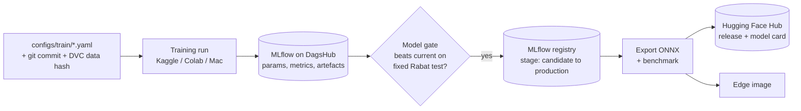

# Review R4: MLOps

Status: **decided** (2026-11-02): MLflow on DagsHub; model gate; DVC for data only (T-025).

## 1. Verdict

Data versioning (DVC + R2) and code CI exist. What's missing is **experiment tracking, a model registry, and reproducible training runs on Kaggle and Colab**. The same lesson as the MinIO dev store applies: whatever the training notebook talks to must be reachable from Kaggle, so a tracker running on the Mac doesn't work.

## 2. Experiment tracking: options

| Option | Reachable from Kaggle/Colab | Free tier | Registry | Lock-in | Notes |
|---|---|---|---|---|---|
| **MLflow on DagsHub** | Yes (hosted, token auth) | Free hosted MLflow server per repo (*check current limits*) | MLflow Model Registry | Low: MLflow is open source, runs can be exported | DagsHub can also mirror the GitHub repo and show DVC data |
| Weights & Biases | Yes (hosted) | 5 GB storage, tracked hours limited by storage (third-party summaries, *verify*) | W&B Registry | Medium (proprietary) | Best UI, public reports are nice for a portfolio |
| MLflow self-hosted on the Mac | **No** | Free | Yes | None | Fails for the same reason as MinIO |

**Recommendation: MLflow on DagsHub.**
- MLflow is the open standard that most enterprises run, so it's the skill worth showing.
- It solves reachability, and it includes a model registry.
- Ultralytics has a built-in MLflow integration.
- Fallback is W&B if the DagsHub free tier proves too tight.

## 3. Model lifecycle

- **One training entry point:** `python -m vbtso.models.train --config configs/train/<name>.yaml`. The Kaggle and Colab notebooks become thin runners: install from the repo at a tag, set secrets, `dvc pull`, run the entry point.
- **Every run logs:** the config, the git commit, the DVC dataset hash, the `uv.lock` hash, the seed, hardware, per-class metrics, and the confusion matrix.
- **Model gate:** a script compares a candidate with the registered model on the fixed Rabat test set and BMD-45 validation set. Promotion only happens if it is not worse on any core class beyond a tolerance. Promotion is a deliberate, logged step.
- **Storage:** weights live in MLflow artefacts and, for releases, in Hugging Face. DVC is for datasets only, so weights aren't duplicated.

## 4. CI for models

- **Per PR (fast):** lint, unit tests, data `validate` on the fixture, Docker builds. This already exists or is planned in P1.
- **Manual or nightly workflow:** a CPU smoke training run (1 epoch on the fixture, a few images), export to ONNX, run the edge stub on a clip. It catches broken training code without GPU cost. It isn't per PR, because PyTorch makes CI slow.
- No training on GitHub runners beyond the smoke test.

## 5. Compute

- Kaggle free GPU (weekly quota, *verify hours*) is the main training budget. Colab is the backup.
- The Mac (MPS) is used for smoke runs and the export and latency benchmarks.
- Budget rule: exploration at small image size and few epochs, full runs only for README numbers.

## 6. Decisions requested
1. **Experiment tracker:** MLflow on DagsHub (recommended) or W&B.
2. Approve the model gate and the "DVC for data only, weights in MLflow + Hugging Face" rule.

## Sources
- DagsHub MLflow tracking, [docs](https://dagshub.com/docs/integration_guide/mlflow_tracking/)
- W&B free plan summary, [CostBench 2026](https://costbench.com/software/mlops/weights-and-biases/free-plan/), [Spheron 2026](https://www.spheron.network/blog/weights-biases-pricing-vs-self-hosted-mlflow-2026/) (third-party; verify on wandb.ai/site/pricing)
