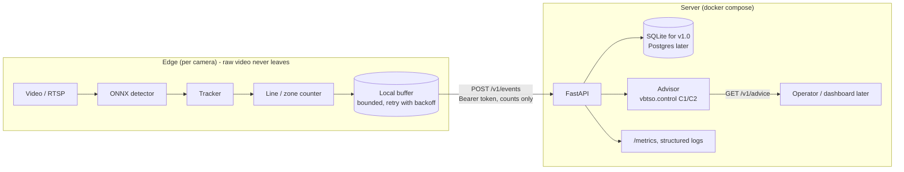

# Review R6: Architecture and production readiness

Status: **decided** (2026-11-02), defaults accepted (T-027).

## 1. Verdict

The privacy boundary (counts-only, schema rejects extra fields) and the container setup are good. Missing for a "client-grade" system:
- persistence and an `/advice` endpoint;
- authentication;
- edge resilience when the API is down;
- structured logs and metrics;
- dependency update automation.

n8n adds nothing that FastAPI doesn't already do, so it's dropped (closes T-007).

## 2. Target architecture (v1.0)

## 3. Recommendations

| Area | Recommendation |
|---|---|
| **API versioning** | Prefix routes with `/v1` now, before any client exists. The schema keeps its own `schema_version`. |
| **Persistence** | SQLite (one file, a volume) for v1.0, behind a small repository layer, so Postgres later is a swap. A unique key on (`camera_id`, `window_start`) makes retried events idempotent. |
| **Advice** | `GET /v1/advice?intersection=...` returns the recommended cycle and green split from the last N windows, computed by `vbtso.control`. The system stays advisory. |
| **Auth** | One bearer token per camera, stored as an environment variable on both sides. TLS terminates at a reverse proxy in any real deployment (out of scope for v1.0, documented). |
| **Edge resilience** | A bounded on-disk queue of events, retries with exponential backoff, and the oldest events dropped first when full (with a counter). The edge never blocks on the API. |
| **Configuration** | `pydantic-settings`: environment variables for secrets and endpoints, YAML for camera and zone config. One settings class per service, validated at start-up (fail fast). |
| **Logging** | Structured JSON logs (stdlib logging + JSON formatter), with camera ID and request ID on every line. Never log frames, URLs with credentials, or tokens. |
| **Metrics** | Prometheus `/metrics` on the API (events received and rejected, latency). The edge reports FPS and mean confidence inside each event (`quality`), which serves as a cheap **drift signal**. |
| **Supply chain** | Dependabot for `uv`, GitHub Actions and Docker base images (weekly, grouped). GitHub secret scanning on. A Trivy image scan in CI is optional. |
| **Privacy** | Counts-only schema (done). The edge has no frame-saving path unless a debug flag is explicitly set, which is off by default and documented. Retention: events are kept 90 days in the demo (configurable). |
| **Releases** | Semantic version tags. On tag: build images and push to GHCR, publish the model release to Hugging Face. No Kubernetes; compose is enough for this scope. |
| **Dashboard** | Not in v1.0 (R1). Later: a small Streamlit page or Grafana on the SQLite/Postgres data. |

## 4. Decisions (default, override if you disagree)
1. FastAPI only, n8n dropped (T-007 closed).
2. SQLite for v1.0, `/v1` routes, bearer token per camera, edge buffer with retry.
3. Dependabot and secret scanning enabled.
