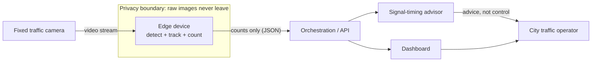
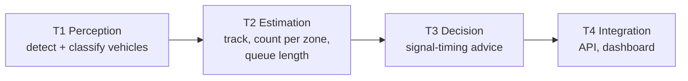
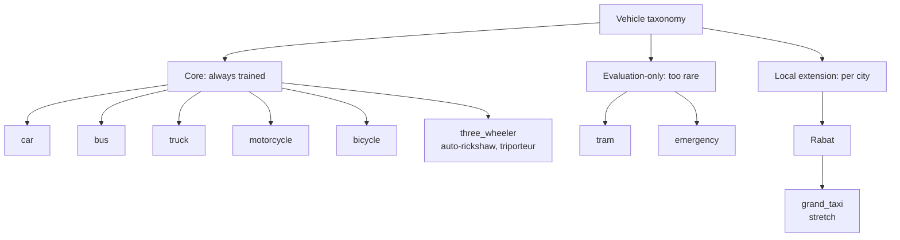
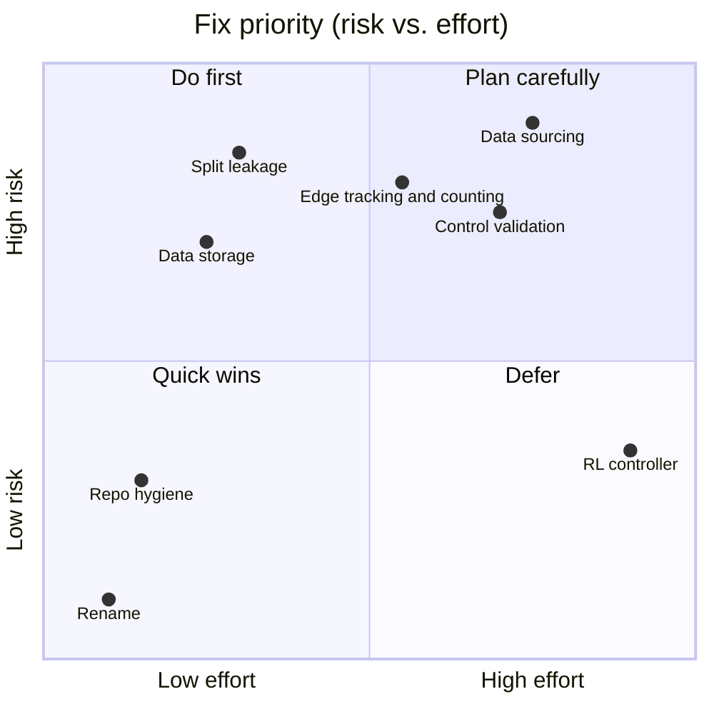
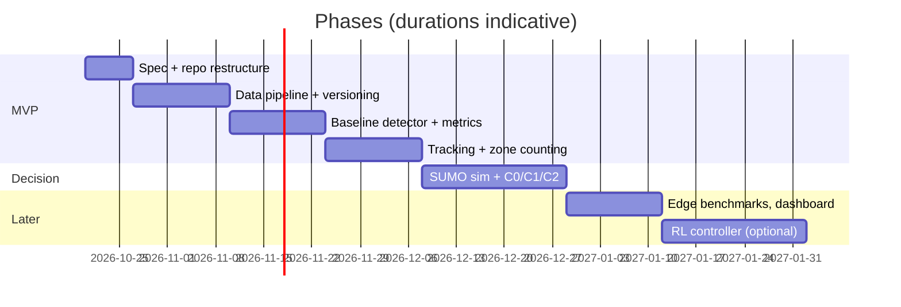

# Functional Specification: Vision-Based Traffic Signal Optimisation (VBTSO)

> **Living document.** Every feature or technology decision updates the relevant section and appends a row to the [Changelog](#9-changelog) and [Decision log](#8-decision-log).
> Status tags: `[Current]` exists in the repo today · `[Critiqued]` reviewed and found weak · `[Proposed]` suggested, not agreed · `[Decided]` agreed with the owner.
> Companion document: [technical_spec.md](technical_spec.md).

**Project name:** Vision-Based Traffic Signal Optimisation (**VBTSO**) `[Decided]`, see D-008. GitHub repository: `vaso-traffic`. Formerly *GreenFlow Rabat* (hackathon name).
**Owner:** Adam Daoudi · **Nature:** personal portfolio project (the RamadnIA 2026 hackathon is over).

---

## 1. Vision and goals `[Decided]`

Turn an ordinary fixed traffic camera into a traffic sensor, and use what it measures to advise signal timing at an intersection, with all image processing kept on the edge.

Because this is a portfolio project, there are two kinds of goals:

| Kind | Goal |
|---|---|
| Product | A pipeline that goes from video to counts to a signal-timing recommendation, validated in simulation. |
| Learning | Practise production-style data engineering (versioned data, reproducible pipelines), deep-network training (tracked experiments, imbalance handling, evaluation) and edge deployment (export, measured latency). |

The learning goals drive the design: when a simple shortcut hides the interesting part, we take the real route.

## 2. Context and scope

### 2.1 System context `[Proposed]`

The system is **advisory**: it recommends green times and never actuates a signal. This keeps the project safe and honest about what a portfolio project can claim.

### 2.2 Users `[Proposed]`

| User | Wants |
|---|---|
| Traffic engineer (target persona) | Counts per approach and a defensible timing recommendation. |
| ML practitioner / reviewer (real audience) | A reproducible repo, clear experiments, honest metrics. |

### 2.3 Capability tiers `[Proposed]`

Each tier has an acceptance metric. A tier is "done" only when its metric is measured, not when the code runs.

| Tier | Output | Acceptance metric (to be calibrated) |
|---|---|---|
| T1 Perception | Boxes + classes per frame | Per-class mAP50 on a **scene-held-out** test set; rare classes reported separately, not averaged away. |
| T2 Estimation | Vehicles crossing a line per interval; queue per approach | Count error vs. a manual count on held-out clips (target: ≤10% MAPE, to be revised after the first measurement). |
| T3 Decision | Green-time recommendation per phase | Average vehicle delay in simulation vs. a fixed-time baseline. |
| T4 Integration | Versioned JSON events, dashboard | Schema validated; end-to-end demo runs from a recorded video. |

### 2.4 Out of scope (for now)

Real signal actuation · multi-intersection coordination · deployment on a real city camera · license-plate reading (privacy, and not needed for counting) · field validation of the controller.

## 3. Domain strategy `[Decided]`

The original project is Rabat-only, with classes such as *Grand Taxi* and *Triporteur*. That is a good hard case but a poor foundation: a recruiter cannot compare it with anything, and the data is too thin (see section 5).

**Decision (review R2):** a city-agnostic core trained on public fixed-CCTV data from a developing city (BMD-45), adapted to Rabat with public Rabat data, plus a small local-class layer.

- Core classes are trained on large public data, so metrics are comparable with published results.
- `three_wheeler` merges Morocco's triporteur with India's auto-rickshaw, so the model learns from thousands of examples instead of 11.
- `tram` and `emergency` are too rare everywhere: they are reported with their counts, never averaged into mAP.
- **No own fixed-camera footage of Rabat exists** (owner, 2026-11-02). Rabat is represented by the YouTube frames: real Rabat streets filmed from a moving car (three videos: day, night, rain). They are used to **fine-tune on two videos and test on the third**, never trained on. MoVITS (public, recorded in Rabat) is added if usable. The story is **domain adaptation**: developing-city fixed CCTV to Rabat streets, with each step measured on the held-out Rabat video. Claims are worded that way (D-009).

## 4. Control problem `[Proposed]`

The original plan called this an "optimal transport problem". Reviewing it: what we are solving is **traffic-signal control**, a queueing and flow-optimisation problem (choose phases and green durations to minimise delay or maximise throughput). Optimal transport in the Wasserstein sense would only apply to adjacent sub-problems (origin-destination estimation, or measuring domain shift between cities). We will not use the term for the controller unless a real OT component is added.

Tiered, so we always have a working baseline to beat:

| Tier | Method | Why |
|---|---|---|
| C0 | Fixed-time plan | The baseline everything is compared to. |
| C1 | Webster's formula / queue-proportional split | Classical, analytic, explainable. |
| C2 | Max-pressure | Strong, decentralised, needs only queue counts. In published SUMO benchmarks it is hard for learning methods to beat. |
| C3 (optional) | Reinforcement learning in SUMO | Learning showcase; only worth it if it is compared fairly against C2. |

The current heuristic (`main.ipynb`: ≥15 vehicles → 90 s green, ≥7.5 → 45 s, else 20 s) is C−1: arbitrary thresholds, no link to demand or to the other approaches `[Critiqued]`.

## 5. Piece-by-piece critique of the current state `[Critiqued]`

Maturity: 1 = idea, 5 = production-grade.

| Component | What exists | Maturity | Main problems |
|---|---|---|---|
| Data sourcing | Frames from 3 YouTube drive-through videos (day, night, rain) | 2 | Driving footage is not a fixed-camera view; licence/privacy unclear; every frame of a video is highly correlated. |
| Data storage | Google Drive, hardcoded paths, Colab mounts | 1 | Not reproducible, no versioning, tied to one vendor. |
| Dataset quality | 6,294 images in splits, only 1,088 annotated, 7,914 boxes | 2 | 89.8% `voiture`; `urgence` 7, `Triporteur` 11, `tram` 12 boxes; 5,206 empty images; frame-level splits probably leak. |
| Model | YOLO26n, 8 classes, Colab/Kaggle | 2 | No final metrics saved; V2 notes mention `image_weights`/`fl_gamma` that are not in the training config; the notebook says YOLO11n elsewhere. |
| Edge runtime | Script in `main.ipynb` | 1 | Counts boxes per frame (not flow); no tracking; fixed thresholds; "QUEUED" message but no queue; example RTSP URL with credentials. |
| Control logic | Threshold rules | 1 | See section 4. |
| Integration | n8n webhook payload | 1 | Ad-hoc schema, unversioned. |
| Repo hygiene | 3 notebooks, rest empty | 1 | Empty README/configs/train.py; incomplete `requirements.txt`. |

## 6. Roadmap `[Proposed]`

**MVP** = recorded video in, per-zone counts out, validated against manual counts, with a simulated baseline comparison started.
**Not now:** RL, multi-intersection, real-camera deployment, mobile apps.

## 7. Open questions

1. ~~Final project name.~~ Resolved, see D-008.
2. ~~Are `tram` and `urgence` core or local classes?~~ Resolved: evaluation-only (section 3).
3. Which public datasets pass the licence check (see technical_spec section 2.3)?
4. ~~Fixed-camera footage of Rabat?~~ Resolved: no own recording; public Rabat data (D-009). Reopen if a vantage point appears.
7. Origin and licence of the legacy `CCTV.v9` Roboflow dataset (owner checking).
5. Which Rabat intersection becomes the simulated case study?
6. ~~Licence of this repo.~~ Resolved: AGPL-3.0 (technical_spec section 3.4, T-013).

## 8. Decision log

| ID | Date | Decision | Status | Rationale |
|---|---|---|---|---|
| D-001 | 2026-10-20 | Personal portfolio project, no longer a hackathon | Decided | Owner. |
| D-002 | 2026-10-20 | Specs in English | Decided | Public portfolio. |
| D-003 | 2026-10-20 | Generic core, Rabat as flagship case | Decided | Comparable metrics, plus a hard local test. |
| D-004 | 2026-10-20 | Free/low-cost compute, object storage + DVC instead of Drive | Decided | Reproducibility, real data-engineering practice. |
| D-005 | 2026-10-20 | Tiered control: fixed-time → Webster/max-pressure → optional RL in SUMO | Decided | Always keep a baseline to beat. |
| D-006 | 2026-10-20 | System is advisory only | Proposed | Safety and honesty of claims. |
| D-007 | 2026-10-20 | Publish datasets/weights on Hugging Face Hub; no VLM pre-labelling or judge-model evaluation; amended 2026-11-02: VLMs allowed offline only for rare-class label QA and as a zero-shot baseline (technical T-012) | Decided | Portfolio visibility without extra complexity. |
| D-008 | 2026-11-02 | Project renamed Vision-Based Traffic Signal Optimisation (VBTSO); repo `vaso-traffic` | Decided | Descriptive name (computer vision applied to signal optimisation), city-agnostic, replaces the hackathon name. |
| D-009 | 2026-11-02 | No own Rabat recording: core trained on BMD-45, Rabat via the YouTube street frames (fine-tune on 2 videos, test on the held-out 3rd) and MoVITS if usable, `grand_taxi` a stretch class; claims say "fine-tuned and evaluated on Rabat street footage", never "validated on Rabat cameras" | Decided | Honest claims; see technical T-018 |

## 9. Changelog

| Date | Change |
|---|---|
| 2026-11-02 | Section 3 and D-009: YouTube Rabat frames used for training and testing, split by video. |
| 2026-11-02 | Review R2: section 3 rewritten (BMD-45 base, `three_wheeler`, evaluation-only rare classes), D-009, open questions 2 and 4 closed, 7 added. |
| 2026-11-02 | Closed open question 6 (licence AGPL-3.0). |
| 2026-11-02 | Amended D-007: offline VLM use allowed (technical T-012). |
| 2026-11-02 | Renamed project to Vision-Based Traffic Signal Optimisation (VBTSO), D-008; closed open question 1; reordered D-006/D-007. |
| 2026-10-20 | Added D-007 (Hugging Face Hub; VLM rejected). |
| 2026-10-20 | First version: vision, tiers, domain strategy, control problem, critique, roadmap. |
