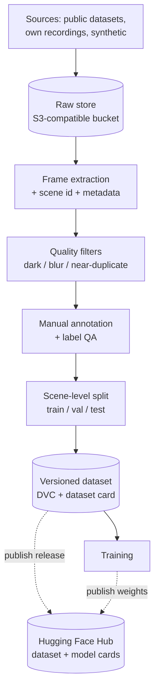
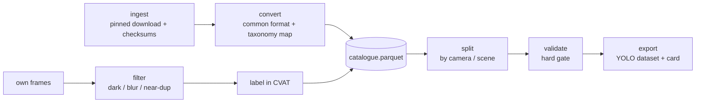
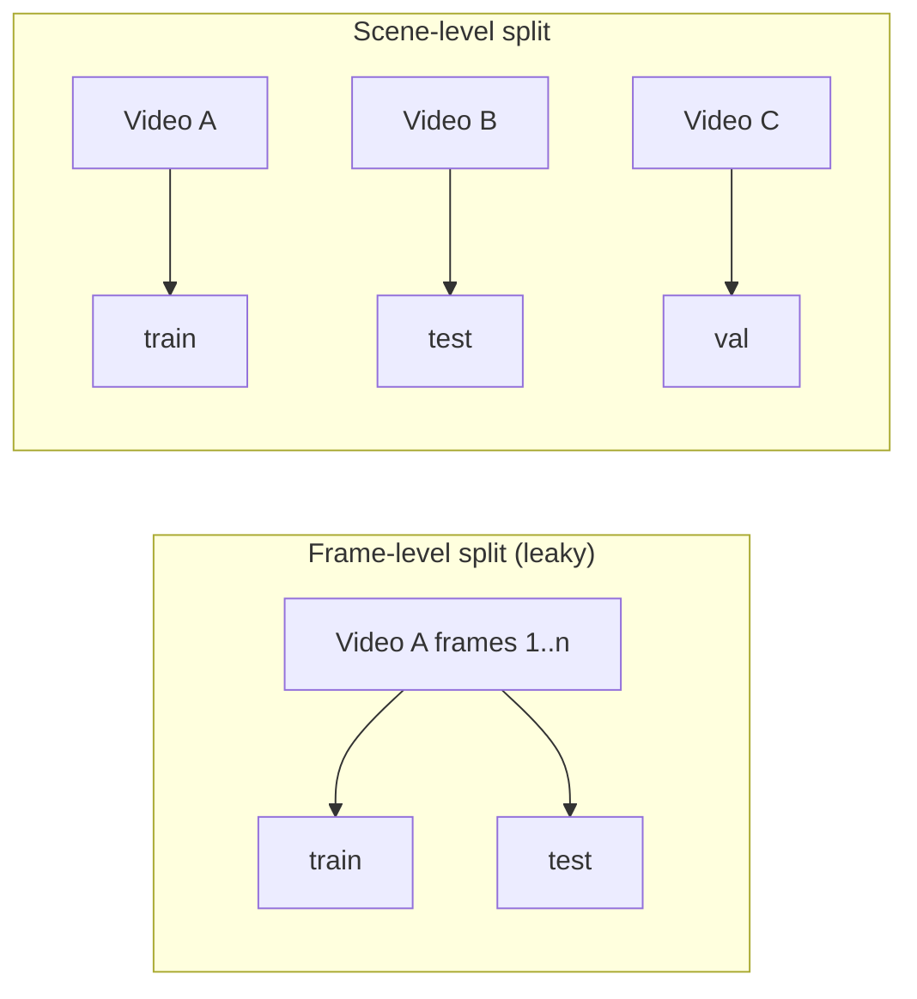
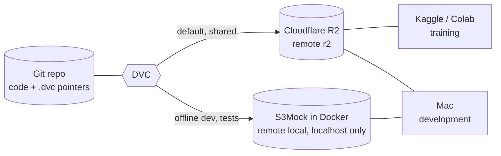
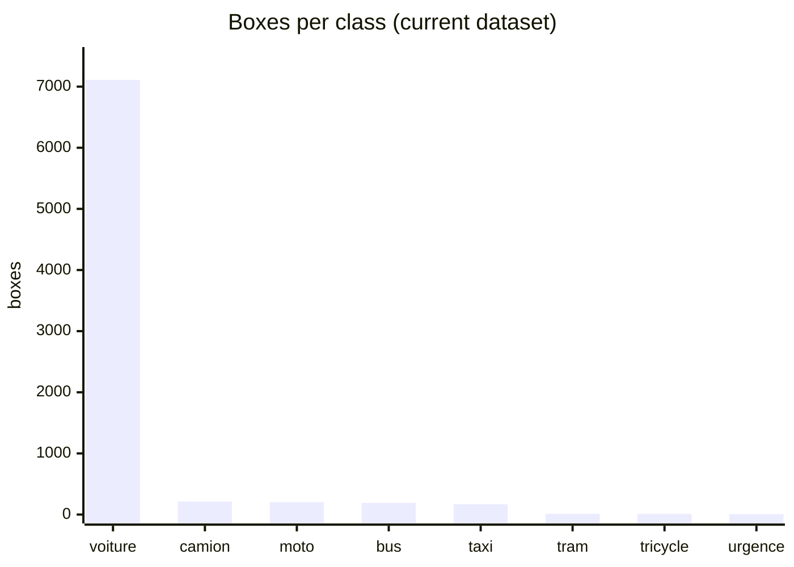
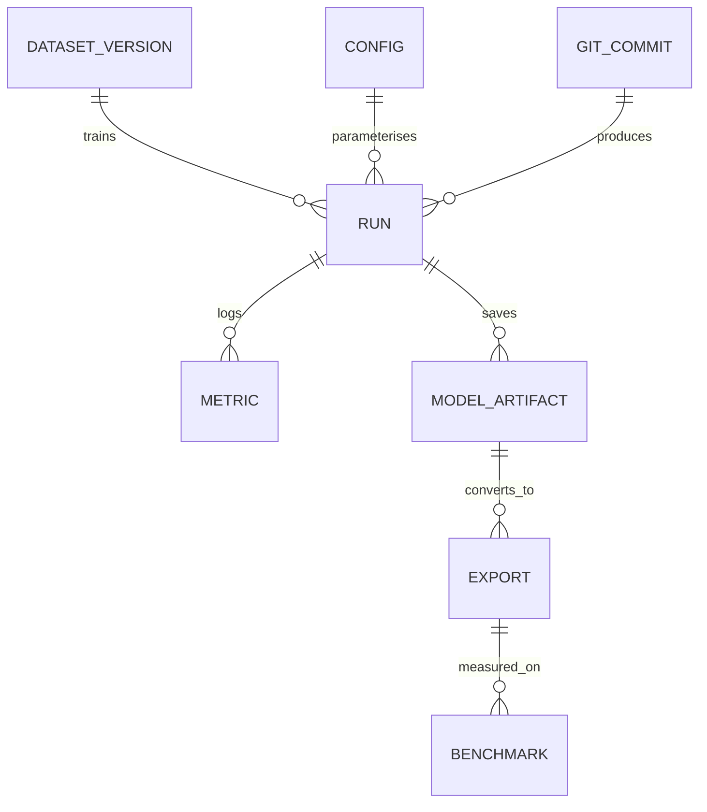
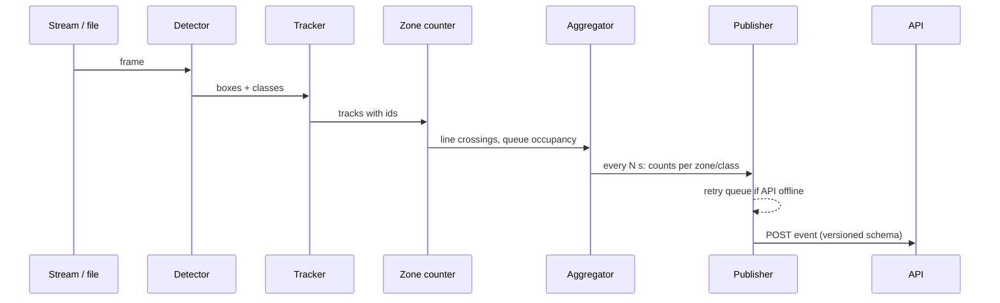
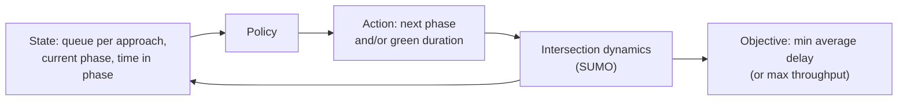
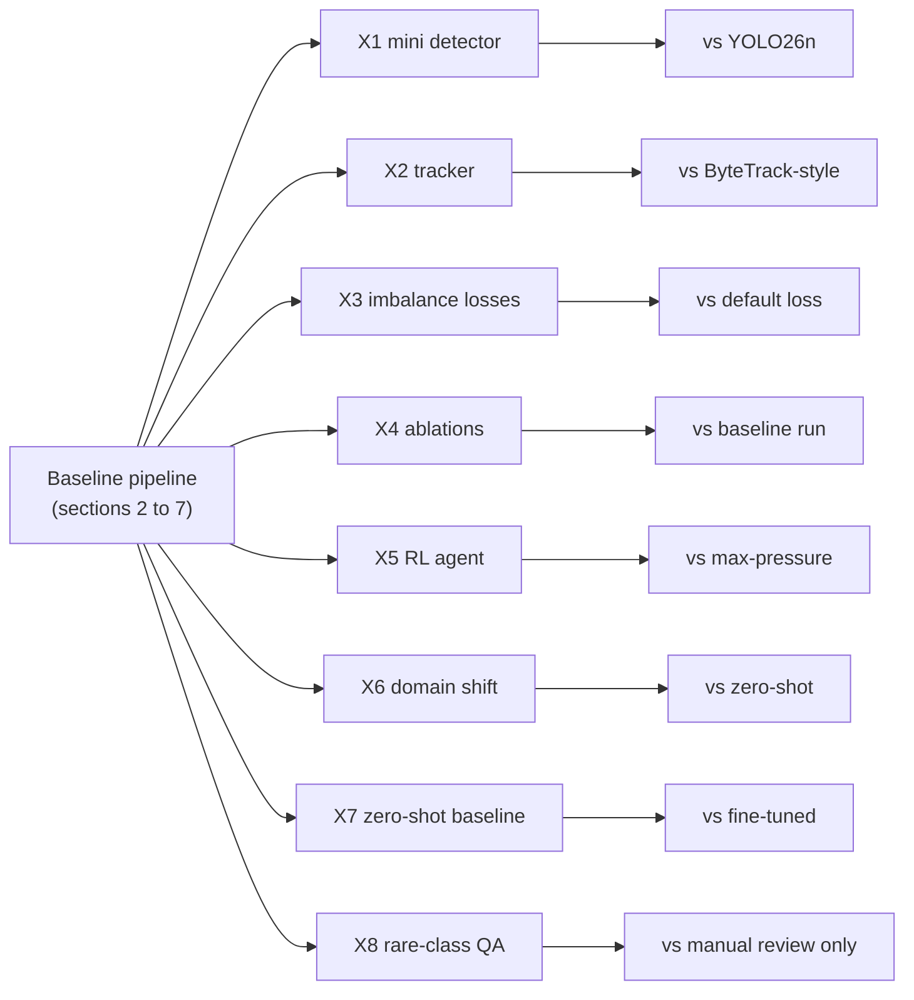

# Technical Specification: Vision-Based Traffic Signal Optimisation (VBTSO)

> **Living document.** Updated with every technology or feature decision; each change is logged in the [Decision log](#10-decision-log) and [Changelog](#11-changelog).
> Status tags: `[Current]` in the repo today · `[Critiqued]` reviewed and found weak · `[Proposed]` suggested · `[Decided]` agreed.
> Companion: [functional_spec.md](functional_spec.md). The stack is **derived from requirements**: where a tool is named, the requirement it serves is stated.

---

## 1. Requirements that drive the stack `[Proposed]`

| ID | Requirement | Drives |
|---|---|---|
| R1 | Any experiment can be reproduced from a git commit (code + data + config) | Data versioning, configs, pinned deps |
| R2 | Metrics must not be inflated by correlated frames | Scene-level splits |
| R3 | Training fits free/low-cost GPUs (Kaggle/Colab) and a Mac for development | Small models, remote runs |
| R4 | Inference runs on a CPU-class edge device | Export and measured latency |
| R5 | Flow, not just boxes: counts per zone over time | Tracking + zone counting |
| R6 | The controller is validated without a real intersection | Simulation |
| R7 | Raw images never leave the edge | Counts-only event schema |

## 2. Data engineering

### 2.1 Current state `[Current]` `[Critiqued]`

Notebook `01_data_engineering.ipynb`: frames every 5 s from YouTube driving videos → watermark masking → three filters (darkness, Laplacian blur, perceptual-hash near-duplicates, moving rejects aside) → manual Roboflow upload. Storage is Google Drive mounted in Colab with hardcoded paths. `notebooks/02` unzips a hand-built `dataset.zip` (made by a gitignored `zip_dataset.py` that is not in the repo).

Problems: not reproducible (R1), no versions, splits not scene-aware (R2), manual steps, no dataset documentation.

### 2.2 Target pipeline `[Proposed]`



- Each stage is a script with a config, run with a pipeline tool (DVC stages), so `dvc repro` rebuilds the dataset.
- Every image carries `scene_id`, `source`, `condition` (day/night/rain), `licence`.
- A **dataset card** records origin, licence, class counts, known biases, and the exact split rule.

### 2.3 Sources `[Decided]`

Full analysis, evidence and licence checks: [`docs/review/R2-data-engineering.md`](docs/review/R2-data-engineering.md).

| Layer | Source | View | Licence | Role |
|---|---|---|---|---|
| Base | **BMD-45** (IISc 2026, 45K images, 480K boxes, 3.6K Safe-City cameras) | Fixed CCTV | CC BY 4.0 (*confirm LICENSE file*) | Core training set |
| Domain | **MoVITS** (Rabat, Mendeley) | Stereo system, *verify fixed or moving* | CC BY-NC-SA 4.0 | Rabat fine-tuning/test, counting ground truth if fixed video |
| Optional | MIO-TCD | Fixed cameras | CC BY-NC-SA 4.0 | Extra pretraining or robustness |
| Eval only | UA-DETRAC | Fixed cameras | *Not confirmed* | Tracking/counting evaluation, once licence confirmed |
| Rabat | **YouTube drive-through frames** (3 videos, 1,329 kept frames, day/night/rain) | Moving, street level | Third-party: training use a grey area, never redistributed | Rabat fine-tuning (2 videos) and held-out test (1 video), split by video; never published |
| Legacy | `CCTV.v9` Roboflow export | Mixed | Unknown (owner checking) | Frozen until licence known |
| Dropped | VisDrone (aerial), BDD100K (dashcam) | – | NC-SA / BSD-3 | Wrong viewpoint |

No own fixed-camera recording is available (owner, 2026-11-02). Rabat is represented by the YouTube street footage (real Rabat traffic, moving camera) and MoVITS if usable. Claims are worded accordingly (functional D-009). More Rabat videos, preferably fixed-viewpoint, are searched for in P1.

Pipeline rules (T-019):
- Public datasets are downloaded by an **ingest** stage at a pinned revision with checksums. They are **not copied into R2**, which keeps the bucket in the free tier and avoids redistribution.
- `configs/taxonomy.yaml` is the class contract: core `car`, `bus`, `truck`, `motorcycle`, `bicycle`, `three_wheeler`; local `grand_taxi` (stretch); `tram` and `emergency` evaluation-only. An unmapped source class fails the pipeline.
- `catalogue.parquet` (DVC-versioned) holds one row per image: `image_id`, `sha256`, `source`, `source_revision`, `camera_id`/`scene_id`, `condition`, `licence`, `split`, per-class box counts. Splits, licence filters, statistics and the dataset card are derived from it.
- A **validate** stage is a hard gate: boxes in bounds, known classes, no near-duplicate across splits, a minimum box count per class per split, empty images at most 15%.
- Labelling of own or relabelled data uses **CVAT, self-hosted** (T-020). Private footage never goes to a public annotation service.



### 2.4 Split policy `[Proposed]`

Frames from one video are near-identical neighbours. A random frame split puts almost-the-same image in train and test and reports mAP that will not hold on a new scene.



Rule: split by `scene_id`; at least one night and one rain scene are held out entirely. Rare classes get reported with their raw box counts.

### 2.5 Storage `[Decided]`

Replace Drive with S3-compatible object storage as the DVC remote. Reasons: versioned, scriptable, usable from Kaggle/Colab/Mac with the same commands, and it is what real teams do.



- **`r2`** is the shared, default remote. It has to be cloud-hosted because Kaggle and Colab cannot reach a store running on the Mac. Free-tier limits and egress terms to be re-checked when the bucket is created (*verify*). Backblaze B2 is the fallback if R2 proves unsuitable.
- **`local`** is a throwaway S3-compatible store (Adobe S3Mock) under Docker Compose, bound to `localhost`. It lets everything be developed and tested offline and without cloud credentials. It is not a production store. MinIO was the first choice, but its images could no longer be pulled from the public registries (checked 2026-11-02); the push, pull and restart-persistence round trip was verified against S3Mock with DVC 3.67.
- Credentials never enter git: AWS-style environment variables (from `.env`, or Kaggle/Colab Secrets) or `.dvc/config.local`.
- Commands and per-machine setup are in `docs/DEVELOPER_GUIDE.md`, section 8.

### 2.6 Hugging Face Hub `[Proposed]`

Role: the **public distribution layer**, not the working store. DVC + the bucket remain the pipeline and versioning backbone (they carry the reproducibility skill, R1); Hugging Face holds the finished artefacts.

| Artefact | On the Hub | Why |
|---|---|---|
| Dataset releases | Dataset repo with a dataset card (origin, licences, class counts, split rule) | Public, versioned, recruiter-visible. Only data whose licences allow redistribution is published; otherwise publish scripts and metadata only. |
| Trained weights | Model repo with a model card (metrics per class, training data version, limits) | One place to pull a released model. |
| Demo (later) | A Space running the detector on uploaded video | Free hosting for a portfolio demo; not MVP. |

Rule: a Hub release is cut from a tagged git commit + DVC dataset version, so it stays reproducible. Evaluation stays metric-based (mAP, count error); no judge model, and no VLM pre-labelling (rejected, see T-008).

## 3. Modelling

### 3.1 Current state `[Current]` `[Critiqued]`

`notebooks/02_model_training.ipynb`: YOLO26n (2,572,280 params), 8 classes (`Grand Taxi, Triporteur, bus, camion, moto, tram, urgence, voiture`), AdamW, lr0 0.001, cosine LR, mosaic/mixup/copy-paste, trained on Colab/Kaggle, exported to ONNX (opset 12).

| Issue | Detail |
|---|---|
| No recorded result | Saved outputs show the config but no final metric; `models/` is empty. |
| Documentation/code drift | Text describes V2 (300 epochs, `image_weights`, `fl_gamma`), while the config shown is V1 (100 epochs) and has neither argument. I believe Ultralytics does not support `image_weights`/`fl_gamma` in its YOLO trainer (*verify against the installed version*). |
| Imbalance | See 3.3. |
| Inconsistent model | `main.ipynb` uses YOLO11n and 4 classes. |
| Everything lives in notebook cells | Not testable or reusable. |

### 3.2 Model choice `[Decided]`

YOLO26n is the default: NMS-free, 40.9 COCO mAP50-95 against 39.5 for YOLO11n, about 31% faster on CPU ONNX (Ultralytics docs). The comparison model is **RF-DETR Nano** (Apache-2.0, vendor-reported 48.4 COCO mAP), which replaces YOLO11n. It is more informative, and it is the licence escape hatch from AGPL (3.4). Both are trained with the same transfer chain (COCO, then BMD-45, then Rabat), on the same splits, and compared on accuracy **and** latency. The `s` size is tried if Mac latency allows. Evaluation protocol: per-class AP with box counts, per condition, on the held-out Rabat video, 3 seeds for published numbers. Details in [`docs/review/R3-computer-vision.md`](docs/review/R3-computer-vision.md) (T-024).

### 3.3 Imbalance handling `[Decided]`

Current counts: voiture 7,109 (89.8%), camion 214, moto 203, bus 190, Grand Taxi 168, tram 12, Triporteur 11, urgence 7.



With 7 to 12 examples, a class cannot be learned or even evaluated reliably: a test split may hold 0 or 1 instance. Plan (T-021), in order:
1. **More data:** BMD-45 brings thousands of boxes for buses, trucks, motorcycles and three-wheelers (the old `Triporteur` merges into core `three_wheeler`).
2. **`cls_pw`:** current Ultralytics class-weight power (0 = off, 1 = full inverse frequency), verified in `ultralytics/cfg/default.yaml` on 2026-11-02. The old notes' `image_weights` and `fl_gamma` **no longer exist** and are dropped.
3. **Dataset-level oversampling** of rare classes in the split/export stage, plus copy-paste augmentation; empty images capped at 15%.
4. **Custom focal and class-balanced losses** stay in X3 as the from-scratch comparison.
5. Classes that still cannot be evaluated (`tram`, `emergency`) are evaluation-only and reported with their box counts, never averaged into mAP.
Evaluation always reports per-class AP with the box count next to it.

### 3.4 Licence `[Decided]`

Ultralytics code and weights are AGPL-3.0 (with a paid Enterprise licence for closed-source use). The repo was MIT, which conflicts once the project imports and distributes AGPL code. Decision T-013: the repo is **AGPL-3.0**, matching its main dependency. Consequence: anyone may reuse the code but must publish their changes, including when it is offered as a network service. If a client ever needs closed-source use, the options are an Ultralytics Enterprise licence or a permissively licensed detector (e.g. Apache-2.0 RT-DETR).

### 3.5 Experiment tracking `[Decided]`



A run is reproducible when (commit, dataset version, config) are all recorded. **Tool: MLflow on DagsHub** (T-006): a hosted MLflow server reachable from Kaggle and Colab, with a model registry; a tracker on the Mac would be unreachable, as MinIO was. Hyperparameters move from notebook cells to `configs/train/*.yaml`, and training has one entry point (`python -m vbtso.models.train --config ...`); notebooks become thin runners. Every run logs config, git commit, DVC dataset hash, `uv.lock` hash, seed, hardware and per-class metrics. A **model gate** promotes a candidate only if it is not worse on any core class on the fixed test sets. DVC versions data only; weights live in MLflow artefacts and, for releases, on Hugging Face. A manual or nightly CPU smoke-training workflow guards the training code. Details in [`docs/review/R4-mlops.md`](docs/review/R4-mlops.md) (T-025).

## 4. Code structure `[Decided]`

Notebooks become exploration only; logic lives in the `vbtso` package (`src` layout).

```text
.
├── README.md  LICENSE  CONTRIBUTING.md
├── functional_spec.md / technical_spec.md
├── pyproject.toml            # single source of dependencies (extras: train, edge, api; group: dev)
├── uv.lock                   # exact versions, committed
├── .python-version           # 3.12
├── justfile                  # task runner: setup, lint, test, check, ...
├── .pre-commit-config.yaml   # ruff, nbstripout, file hygiene
├── .env.example              # variable names only, never values
├── dvc.yaml  .dvc/           # pipeline + data remote (milestone M2)
├── configs/                  # data.yaml, train/*.yaml, edge.yaml, zones/*.yaml
├── src/vbtso/
│   ├── data/                 # extract, filter, split, validate        (P1)
│   ├── models/               # train, eval, export                     (P2)
│   ├── edge/                 # edge worker entrypoint (stub today)    (P3)
│   ├── tracking/             # tracker, zone counter                   (P3)
│   ├── control/              # fixed_time, webster, max_pressure, rl   (P4)
│   └── api/                  # event schema v1, ingestion service      (P5)
├── tests/                    # unit tests on pure functions + schema tests
├── notebooks/                # exploration only (legacy, ruff-excluded)
├── docs/                     # DEVELOPER_GUIDE.md, legacy_results.md
├── docker/                   # api.Dockerfile, edge.Dockerfile
├── docker-compose.yml        # dev store (s3mock), api, edge (profile)
├── scripts/                  # github_setup.sh
└── .github/                  # workflows, issue and PR templates
```

Dependency model: the core install is tiny (`numpy`, `pyyaml`). Heavy stacks are **extras** so each environment installs only what it needs: `train` on Mac/Kaggle/Colab, `edge` on the device and in the edge image, `api` in the service image. Developer tools are a uv **dependency group** (`dev`) and are never installed on Kaggle/Colab or in images. The old `requirements.txt` (which lacked `pyyaml`, `imagehash`, `matplotlib`, `Pillow`) is removed.

## 5. Edge runtime

### 5.1 Current state `[Current]` `[Critiqued]`

`main.ipynb` cell 7 loops over RTSP frames, runs the model, and every 30 s counts boxes **in one frame** and posts them. Problems: a single frame count is not flow (R5); no tracking, so the same car is not recognised across frames; thresholds hardcoded; "QUEUED" is printed but nothing is queued; credentials in the example URL; reconnect logic creates a new capture without releasing the old one.

### 5.2 Target design `[Decided]`



- Tracker: BoT-SORT or ByteTrack (both built into Ultralytics; BoT-SORT 64.6 against 63.1 HOTA on MOT17), chosen on our own clips. At the edge, a standalone tracker (X2 or a light ByteTrack port) avoids shipping Ultralytics.
- **Counting is the product metric:** count MAPE per line per 5-minute window against manual counts made in CVAT. Line crossings use confirmed track IDs with hysteresis.
- Zones/lines: per-camera config in `configs/zones/<camera>.yaml` (polygons per approach/lane).
- Queue estimate: vehicles stationary inside an approach zone.
- A recorded video can replace the stream, so the whole path is testable offline.
- The edge runs the **ONNX model through ONNX Runtime with our own pre- and post-processing**, with no PyTorch or Ultralytics at runtime (T-026). Events are buffered on disk and retried with backoff when the API is down (T-027).

### 5.3 Export and benchmarks `[Decided]`

Formats benchmarked on the hardware that exists, the Mac (T-026): PyTorch-MPS (reference), **ONNX + ONNX Runtime CPU (deployment format)**, Core ML (optional), ONNX INT8 (experiment). OpenVINO, TensorRT and NCNN are out until matching hardware exists. Per format: Rabat-test mAP drop, latency p50/p95, FPS, size. Details in [`docs/review/R5-ai-engineering.md`](docs/review/R5-ai-engineering.md). The notebook's claims ("RPi5 NCNN ~10 to 14 FPS", "Jetson Orin 80+ FPS") are unsourced `[Critiqued]`; replace them with measured numbers on the device we actually have (the Mac CPU at minimum), with latency, FPS and accuracy drop recorded per format.

## 6. Control and simulation

### 6.1 Formulation `[Decided]`



| Tier | Controller | Input needed |
|---|---|---|
| C0 | Fixed-time, **Webster-tuned** per demand scenario: `C = (1.5 L + 5) / (1 - Y)`, greens proportional to `y_i` | Average flows (offline) |
| C1 | Adaptive Webster / queue-proportional split, recomputed each cycle | Counts per approach, last window |
| C2 | Max-pressure (Varaiya). Camera-only, it reduces to the largest weighted queue, because downstream queues are unseen | Queue per approach (and downstream if known) |
| C3 | RL (stretch, after v1.0), via sumo-rl | Same state, plus training episodes |

All controllers respect the same safety constraints: minimum and maximum green, amber, all-red, pedestrian minimum. C0 to C2 are pure functions in `vbtso.control` (state in, decision out), unit-tested without SUMO, behind a thin TraCI adapter. The same functions serve the API's `/v1/advice` (T-028).

The state the controller needs must be producible by T2 (zone queue + counts). If perception cannot supply it, the controller is not valid. This is the main coupling risk between the two halves.

### 6.2 Validation `[Decided]`

First a sanity check on a RESCO single-intersection network shipped with **sumo-rl** (MIT), against RESCO's published fixed-time, greedy and max-pressure baselines. Then **one real Rabat signalised 4-way junction** from OpenStreetMap (`netconvert`), proposed during P4 and confirmed by the owner. Demand is synthetic, with **4 scenarios** (low, medium, high, unbalanced) loosely informed by Rabat footage counts. This is stated as an assumption.

Three sensing models:
1. Ideal (SUMO lane-area detectors).
2. Camera-only (approaches, no downstream).
3. Noisy (errors drawn from the measured P3 count error, worse at night).

Metrics: mean delay per vehicle, mean and maximum queue, throughput, stops. **10 seeds per scenario**, mean and 95% CI, warm-up discarded. Headline result: delay against perception error, which shows how good the camera must be for adaptive control to pay off. Details in [`docs/review/R7-algorithms-and-methodology.md`](docs/review/R7-algorithms-and-methodology.md).

Published SUMO benchmarks (e.g. RESCO) report fixed-time, greedy and max-pressure baselines against learning methods, and note that max-pressure is hard to beat, which is why C2 is the real bar for C3 (*benchmark claims from search results; read RESCO's paper before quoting numbers*).

## 7. Integration `[Decided]`

Replace the ad-hoc payload with a versioned schema (counts only, R7). Candidate v1:

```json
{
  "schema_version": "1.0",
  "camera_id": "string",
  "window_start": "2026-10-20T10:00:00Z",
  "window_seconds": 30,
  "zones": [
    {
      "zone_id": "north_approach",
      "crossings": {"car": 12, "bus": 1, "motorcycle": 3},
      "queue_vehicles": 4
    }
  ],
  "quality": {"fps": 14.2, "mean_confidence": 0.71}
}
```

**FastAPI only, n8n dropped** (T-007). Routes are versioned (`/v1/events`, `/v1/advice`, `/health`, `/metrics`). Events go to SQLite for v1.0 behind a repository layer (Postgres later), idempotent on (`camera_id`, `window_start`). Each camera authenticates with its own bearer token. Logs are structured JSON, and the API exposes Prometheus metrics. Configuration uses `pydantic-settings`. Dependabot and secret scanning are on. No images, no coordinates, no plate text in the payload. Details in [`docs/review/R6-architecture-and-production.md`](docs/review/R6-architecture-and-production.md) (T-027).

## 8. Testing and validation `[Decided]`

| Layer | Test |
|---|---|
| Data | Schema checks, no scene appears in two splits, class counts match the card. |
| Model | Per-class AP with box counts on the held-out Rabat video and BMD-45 validation; model gate before promotion (T-025); CPU smoke-training workflow on a tiny fixture. |
| Tracking/counting | Count MAPE per line per 5-min window vs. manual CVAT counts; HOTA/IDF1 where ground-truth tracks exist. |
| Control | Unit tests of C0 to C2 as pure functions; SUMO comparison, 10 seeds, 3 sensing models. |
| Integration | Pydantic schema tests (done); API tests; compose end-to-end run (edge to API to advice). |

## 9. Custom implementations and ablations `[Proposed]`

The pipeline uses off-the-shelf components (Ultralytics detector, ByteTrack-style tracker, SUMO). This section lists the parts we also write ourselves, each compared against its off-the-shelf counterpart on the same data, so the project demonstrates the underlying algorithms and not only the tooling. Every item is additive: the baseline pipeline in sections 2 to 7 works without any of them, and an item is dropped if it does not pay off.

| ID | Component | What we write | Compared against | Acceptance check |
|---|---|---|---|---|
| X1 | Mini detector *(stretch, after v1.0)* | Small anchor-free detector in PyTorch: backbone, detection head, GIoU loss, NMS | YOLO26n on the same scene-level split | Per-class mAP50 reported for both; gap and likely causes documented. |
| X2 | Tracker *(if time allows)* | Kalman filter (constant-velocity) plus Hungarian matching on IoU | ByteTrack-style tracker from Ultralytics | Same clips: ID switches and zone-count error for both. |
| X3 | Imbalance loss | Focal loss and class-balanced loss implemented from the papers | Default loss; oversampling of rare classes | Ablation table with per-class AP for `urgence`, `Triporteur`, `tram`; replaces the unsupported `fl_gamma` setting (section 3.3). |
| X4 | Ablation study | Controlled sweeps over input resolution, augmentation and model size | The baseline run | One run per factor, one change at a time, all logged in the tracker (section 3.5); results in a single table. |
| X5 | RL controller (C3) *(stretch, after v1.0)* | DQN or PPO agent over the SUMO state defined in section 6.1 | C2 max-pressure, C0 fixed-time | Average delay over several demand levels and seeds; reported as a win only if it beats max-pressure. |
| X6 | Domain-shift experiment | Train on public data, test on Rabat footage, then fine-tune | Zero-shot result | mAP before and after fine-tuning; a plot of mAP against the number of Rabat images used. |
| X7 | Zero-shot baseline | Evaluation script running an open-vocabulary detector (e.g. Grounding DINO, OWL-ViT) on the held-out Rabat frames, no training | Our fine-tuned detector | Extra row in the X6 table: mAP50 per class, zero-shot versus trained. Offline only. |
| X8 | Rare-class label QA *(if time allows)* | Offline script: a small open-source VLM classifies cropped boxes of `urgence`, `Triporteur`, `tram`; disagreements are queued for manual re-check | Manual review alone | Number of label errors found, and per-class AP before and after correction. The VLM never writes labels. |



Order of work: X3 and X4 first (cheap, they reuse the existing training loop), then X2, then X1, then X6, with X7 beside it (same test set) and X8 once the rare-class crops are annotated. X5 comes last and only after C2 works in SUMO (section 6.2). Each item gets its own tracked run and a short write-up in the repo, whether or not it beats the baseline.

## 10. Decision log

| ID | Date | Decision | Status | Requirement |
|---|---|---|---|---|
| T-001 | 2026-10-20 | S3-compatible bucket + DVC instead of Google Drive | Decided (provider: Cloudflare R2, see T-016) | R1, R3 |
| T-002 | 2026-10-20 | Split by scene, not frame | Proposed | R2 |
| T-003 | 2026-10-20 | Keep YOLO26n as default, benchmark vs YOLO11n | Superseded by T-024 | R3, R4 |
| T-004 | 2026-10-20 | Tracking + zone counting replaces per-frame counts | Decided | R5 |
| T-005 | 2026-10-20 | SUMO as controller validation ground truth | Decided (set-up in T-028) | R6 |
| T-006 | 2026-10-20 | Experiment tracker: W&B or MLflow | Decided 2026-11-02: MLflow on DagsHub (T-025) | R1 |
| T-007 | 2026-10-20 | Integration layer: n8n vs FastAPI | Decided 2026-11-02: FastAPI only (T-027) | R7 |
| T-008 | 2026-10-20 | VLM/foundation-model pre-labelling and judge-model evaluation | Rejected (owner); amended 2026-11-02 by T-012 | Manual annotation + metric-based evaluation instead; avoids extra complexity |
| T-009 | 2026-10-20 | Hugging Face Hub for publishing datasets, weights, model/dataset cards (DVC stays the working store) | Decided | R1 |
| T-010 | 2026-11-02 | Project renamed VBTSO (see functional D-008); repo `vaso-traffic`; use `vbtso` as the Python package name when `src/` is created | Decided | Naming consistency |
| T-011 | 2026-11-02 | Add custom implementations and ablations X1 to X6 (section 9), each compared against its off-the-shelf counterpart; all optional and additive | Proposed | R3, R4, R5, R6 |
| T-012 | 2026-11-02 | Allow VLMs offline only: rare-class label QA (X8) and zero-shot baseline (X7). Still rejected: pre-labelling, judge-model evaluation, any VLM in the edge runtime or payload | Decided | R2, R3; keeps the privacy boundary and the metric-based evaluation |
| T-013 | 2026-11-02 | Repo licence AGPL-3.0 (replaces MIT) | Decided | Matches Ultralytics AGPL-3.0 (section 3.4) |
| T-014 | 2026-11-02 | Workflow: protected main, branch + PR for every change, squash-merge, Conventional Commits (extra types `exp`, `data`), GitHub issues and milestones; see CONTRIBUTING.md and docs/DEVELOPER_GUIDE.md | Decided | Traceability, enterprise-style process |
| T-015 | 2026-11-02 | Environment: uv (Python 3.12, `pyproject.toml` + committed `uv.lock`) replaces conda/pip/`requirements.txt`; `just` as task runner; ruff + pytest; pre-commit (ruff, nbstripout); heavy deps as extras (`train`, `edge`, `api`), tooling as a `dev` group | Decided | R1, R3 |
| T-016 | 2026-11-02 | DVC remotes: `r2` (Cloudflare R2, shared, default) and `local` (S3Mock in Docker, offline dev); credentials only through environment variables or git-ignored `.dvc/config.local`; store bound to localhost, no real data | Decided | R1, R3; Kaggle/Colab cannot reach a MinIO on the Mac, so the shared remote must be cloud-hosted |
| T-017 | 2026-11-02 | Containers: multi-stage uv-based images for `api` and `edge` only (training stays on uv), `python:3.12.12-slim-bookworm` and uv 0.13.5 pinned, non-root user, API health check, edge has no port; compose with profile `edge`; CI builds both images on PRs; images built for the host architecture, multi-arch deferred until a hardware target exists | Decided | R3 (reproducible deploy), R7 |
| T-018 | 2026-11-02 | Data strategy: BMD-45 (fixed CCTV, CC BY 4.0) as base, Rabat via the YouTube street frames (fine-tune on 2 videos, test on the held-out 3rd) and MoVITS if usable; VisDrone and BDD100K dropped | Decided | R2, R3; review R2 |
| T-019 | 2026-11-02 | Data pipeline: pinned ingest (public data not copied to R2), taxonomy contract `configs/taxonomy.yaml` with core `three_wheeler`, `catalogue.parquet`, validate stage as hard gate | Decided | R1, R2 |
| T-020 | 2026-11-02 | Labelling with CVAT self-hosted (Docker); Roboflow free plan rejected for private footage (public projects) | Decided | R7 privacy |
| T-021 | 2026-11-02 | Imbalance: `cls_pw` + dataset oversampling + copy-paste + negative cap; `image_weights`/`fl_gamma` dropped (removed from Ultralytics) | Decided | R3 |
| T-022 | 2026-11-02 | Release rules: own raw footage never published; faces and plates blurred before any release; CC BY and NC-SA data released separately; model cards state training-data licences | Decided | R7, licences |
| T-023 | 2026-11-02 | MVP = v1.0 (T1 to T4 measured, C0 to C2 in SUMO); stretch after v1.0: X1, X5 (RL), dashboard, HF Space, hardware | Decided | Review R1, functional D-010 |
| T-024 | 2026-11-02 | Detector: YOLO26n default, RF-DETR Nano (Apache-2.0) as comparison instead of YOLO11n; per-class/per-condition evaluation, 3 seeds for published numbers; count MAPE is the T2 metric | Decided | Review R3 |
| T-025 | 2026-11-02 | MLOps: MLflow on DagsHub (tracking + registry), single training entry point and configs, model gate, DVC for data only, CPU smoke-training workflow | Decided | Review R4 |
| T-026 | 2026-11-02 | Export and serving: ONNX Runtime at the edge without PyTorch/Ultralytics; benchmarks on the Mac (PyTorch-MPS, ONNX, Core ML, ONNX INT8); OpenVINO/TensorRT/NCNN out until hardware exists | Decided | Review R5 |
| T-027 | 2026-11-02 | Architecture: FastAPI only, `/v1` routes, SQLite for v1.0, idempotent events, per-camera bearer token, edge disk buffer with retry, JSON logs, Prometheus metrics, pydantic-settings, Dependabot | Decided | Review R6 |
| T-028 | 2026-11-02 | Control and simulation: Webster-tuned C0, shared safety constraints, controllers as pure functions, RESCO sanity check, one Rabat junction from OSM (proposed in P4), 4 demand scenarios, 3 sensing models, 10 seeds | Decided | Review R7 |

## 11. Changelog

| Date | Change |
|---|---|
| 2026-11-02 | Reviews R1, R3 to R7 done: 3.2, 3.5, 5.2, 5.3, 6.1, 6.2, 7 decided; T-003 superseded, T-004 to T-007 resolved; T-023 to T-028. |
| 2026-11-02 | YouTube Rabat frames used for fine-tuning and testing (split by video), not only as an OOD test; 2.3 and T-018 updated. |
| 2026-11-02 | Review R2 (data engineering): 2.3 rewritten from verified sources, 3.3 imbalance corrected (`cls_pw`), T-018 to T-022. |
| 2026-11-02 | M3 containers: api and edge images, schema v1 pydantic model and /events stub, edge stub, compose, CI image build (T-017). |
| 2026-11-02 | M2 data platform: DVC remotes r2 + local (T-016), docker-compose with an S3Mock dev store (MinIO images unavailable), just recipes, guide section 8. |
| 2026-11-02 | M1 environment: section 4 rewritten to the real repo layout; T-015 (uv, just, ruff, pre-commit, CI). |
| 2026-11-02 | M0 governance: licence AGPL-3.0 (3.4, T-013), contribution workflow (T-014). |
| 2026-11-02 | Amended T-008 with T-012: offline VLM use allowed (X7, X8 in section 9). |
| 2026-11-02 | Added section 9, custom implementations and ablations (T-011); decision log, changelog and sources renumbered to 10 to 12. |
| 2026-11-02 | Renamed project to VBTSO (T-010). |
| 2026-10-20 | Added Hugging Face Hub (2.6, T-009); removed VLM pre-labelling from pipeline and sourcing (T-008). |
| 2026-10-20 | First version, from a full read of `main.ipynb`, `notebooks/01`, `notebooks/02`; external facts from web searches (YOLO26, dataset licences, SUMO benchmarks), several flagged *verify*. |

## 12. Sources consulted

- [Ultralytics YOLO26 page](https://www.ultralytics.com/yolo/yolo26) and [Roboflow YOLO26 model page](https://inference-models.roboflow.com/models/yolo26-object-detection/): NMS-free design, sizes, AGPL-3.0/Enterprise licensing.
- [UA-DETRAC paper](https://arxiv.org/pdf/1511.04136): fixed-camera detection and tracking benchmark.
- [RESCO benchmark](https://github.com/behradkoohy/RESCO): SUMO signal-control baselines and learning methods.
