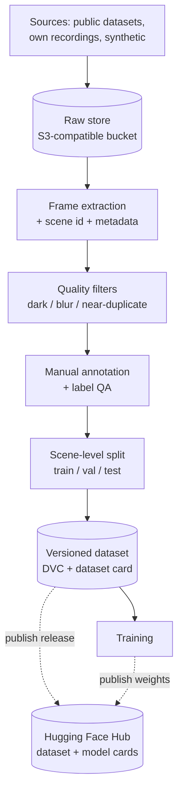
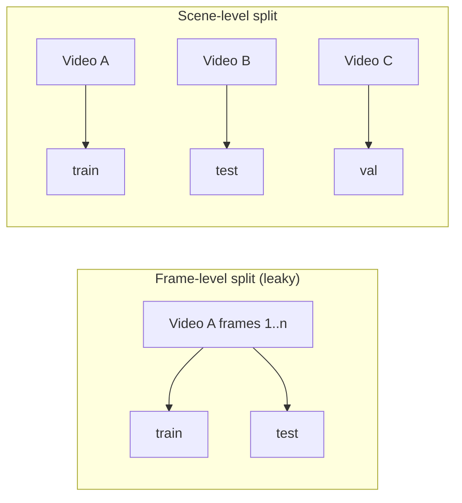
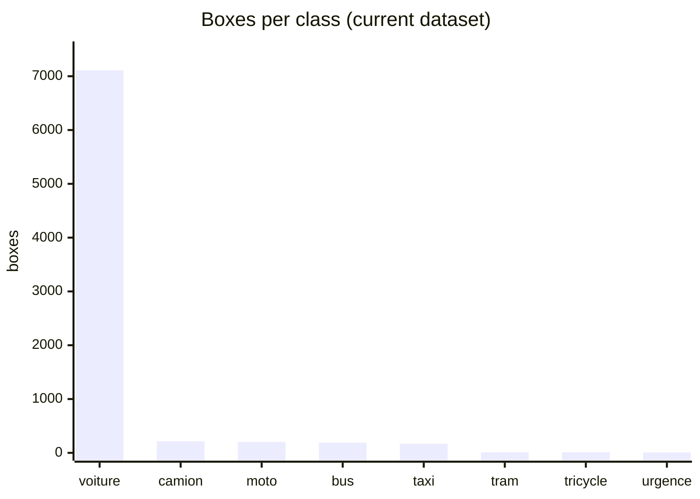
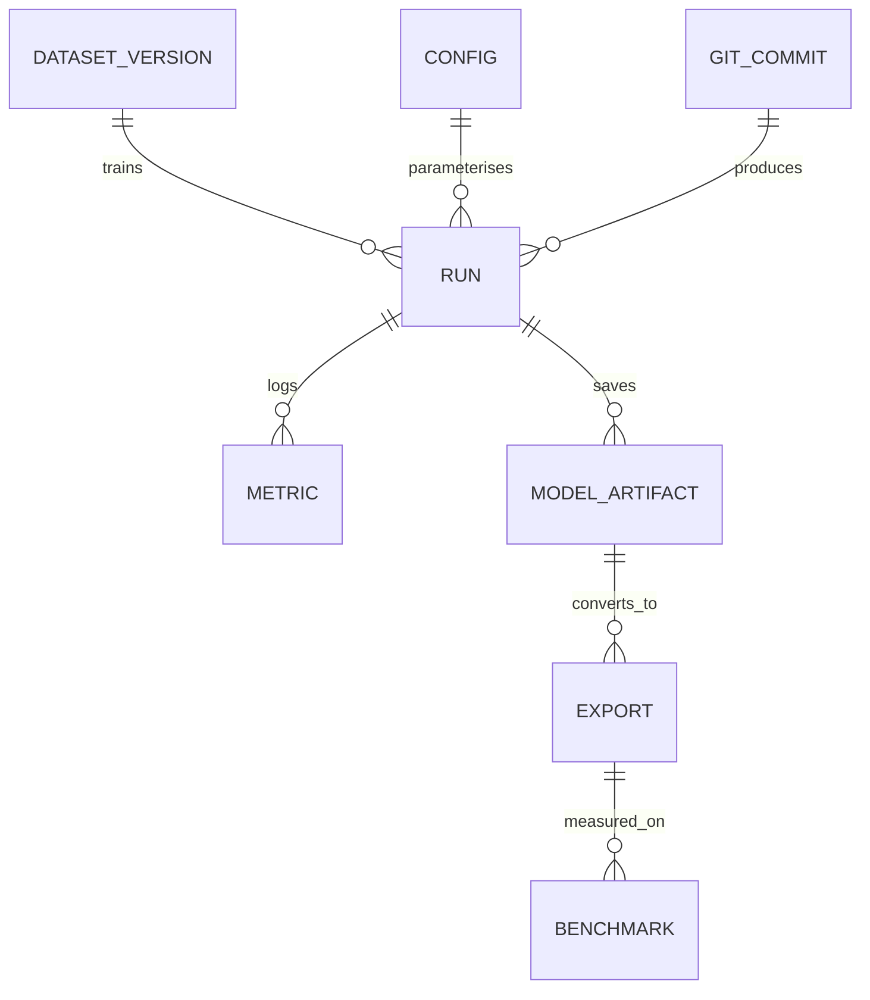
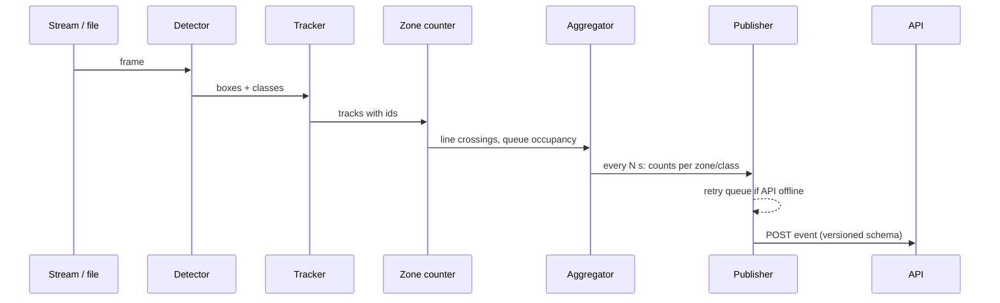
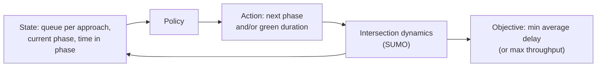

# Technical Specification

> **Living document.** Updated with every technology or feature decision; each change is logged in the [Decision log](#9-decision-log) and [Changelog](#10-changelog).
> Status tags: `[Current]` in the repo today · `[Critiqued]` reviewed and found weak · `[Proposed]` suggested · `[Decided]` agreed.
> Companion: [functional_spec.md](functional_spec.md). The stack is **derived from requirements**: where a tool is named, the requirement it serves is stated.

---

## 1. Requirements that drive the stack `[Proposed]`

| ID | Requirement | Drives |
|---|---|---|
| R1 | Any experiment can be reproduced from a git commit (code + data + config) | Data versioning, configs, pinned deps |
| R2 | Metrics must not be inflated by correlated frames | Scene-level splits |
| R3 | Training fits free/low-cost GPUs (Kaggle/Colab) and a Mac for development | Small models, remote runs |
| R4 | Inference runs on a CPU-class edge device | Export and measured latency |
| R5 | Flow, not just boxes: counts per zone over time | Tracking + zone counting |
| R6 | The controller is validated without a real intersection | Simulation |
| R7 | Raw images never leave the edge | Counts-only event schema |

## 2. Data engineering

### 2.1 Current state `[Current]` `[Critiqued]`

Notebook `01_data_engineering.ipynb`: frames every 5 s from YouTube driving videos → watermark masking → three filters (darkness, Laplacian blur, perceptual-hash near-duplicates, moving rejects aside) → manual Roboflow upload. Storage is Google Drive mounted in Colab with hardcoded paths. `notebooks/02` unzips a hand-built `dataset.zip` (made by a gitignored `zip_dataset.py` that is not in the repo).

Problems: not reproducible (R1), no versions, splits not scene-aware (R2), manual steps, no dataset documentation.

### 2.2 Target pipeline `[Proposed]`



- Each stage is a script with a config, run with a pipeline tool (DVC stages), so `dvc repro` rebuilds the dataset.
- Every image carries `scene_id`, `source`, `condition` (day/night/rain), `licence`.
- A **dataset card** records origin, licence, class counts, known biases, and the exact split rule.

### 2.3 Sourcing decision matrix `[Proposed]`

The single largest weakness is data. Matrix to fill in; entries marked *verify* were not confirmed from official licence texts.

| Source | Domain match | Labels | Licence | Effort | Notes |
|---|---|---|---|---|---|
| Own YouTube drive videos (current) | Poor (moving camera) | None | Unclear; platform terms, third-party footage | Low | Keep as a hard out-of-domain **test**, not as the training core. |
| UA-DETRAC | Good (fixed traffic cameras) | Boxes + tracks | *Verify* (research terms likely) | Low | Also gives tracking ground truth for T2. |
| VisDrone | Medium (aerial) | Boxes | *Verify* | Low | Different viewpoint; use for robustness only. |
| BDD100K | Medium (dashcam) | Boxes | *Verify* (sources conflict: BSD-3 vs. "other") | Low | Day/night/rain variety. |
| Roboflow Universe public sets | Variable | Boxes | Per dataset | Low | Check each licence; label taxonomies differ. |
| Synthetic (CARLA / SUMO + renderer) | Controllable | Free, exact | Own | Medium | Can generate rare classes and weather; sim-to-real gap to measure. |
| Own fixed-camera recording | Best | Manual | Own | High | Only if a safe vantage point is available; plate/face privacy applies. |

### 2.4 Split policy `[Proposed]`

Frames from one video are near-identical neighbours. A random frame split puts almost-the-same image in train and test and reports mAP that will not hold on a new scene.



Rule: split by `scene_id`; at least one night and one rain scene are held out entirely. Rare classes get reported with their raw box counts.

### 2.5 Storage `[Proposed]`

Replace Drive with an S3-compatible bucket (candidates: Cloudflare R2, Backblaze B2, or MinIO locally) as the DVC remote. Reasons: versioned, scriptable, usable from Kaggle/Colab/Mac with the same commands, and it is what real teams do. Cost on free tiers to be checked at setup (*verify*).

### 2.6 Hugging Face Hub `[Proposed]`

Role: the **public distribution layer**, not the working store. DVC + the bucket remain the pipeline and versioning backbone (they carry the reproducibility skill, R1); Hugging Face holds the finished artefacts.

| Artefact | On the Hub | Why |
|---|---|---|
| Dataset releases | Dataset repo with a dataset card (origin, licences, class counts, split rule) | Public, versioned, recruiter-visible. Only data whose licences allow redistribution is published; otherwise publish scripts and metadata only. |
| Trained weights | Model repo with a model card (metrics per class, training data version, limits) | One place to pull a released model. |
| Demo (later) | A Space running the detector on uploaded video | Free hosting for a portfolio demo; not MVP. |

Rule: a Hub release is cut from a tagged git commit + DVC dataset version, so it stays reproducible. Evaluation stays metric-based (mAP, count error); no judge model, and no VLM pre-labelling (rejected, see T-008).

## 3. Modelling

### 3.1 Current state `[Current]` `[Critiqued]`

`notebooks/02_model_training.ipynb`: YOLO26n (2,572,280 params), 8 classes (`Grand Taxi, Triporteur, bus, camion, moto, tram, urgence, voiture`), AdamW, lr0 0.001, cosine LR, mosaic/mixup/copy-paste, trained on Colab/Kaggle, exported to ONNX (opset 12).

| Issue | Detail |
|---|---|
| No recorded result | Saved outputs show the config but no final metric; `models/` is empty. |
| Documentation/code drift | Text describes V2 (300 epochs, `image_weights`, `fl_gamma`), while the config shown is V1 (100 epochs) and has neither argument. I believe Ultralytics does not support `image_weights`/`fl_gamma` in its YOLO trainer (*verify against the installed version*). |
| Imbalance | See 3.3. |
| Inconsistent model | `main.ipynb` uses YOLO11n and 4 classes. |
| Everything lives in notebook cells | Not testable or reusable. |

### 3.2 Model choice `[Proposed]`

YOLO26 is an NMS-free Ultralytics model family released around late 2025 (sources disagree on the exact date) with nano to extra-large sizes. Ultralytics' own docs recommend YOLO26 and YOLO11 for stable production use. We keep YOLO26n as the default **but benchmark it** against YOLO11n (and optionally an RT-DETR-class model) on the same scene-level split before deciding, because the choice should be a measurement.

### 3.3 Imbalance handling `[Proposed]`

Current counts: voiture 7,109 (89.8%), camion 214, moto 203, bus 190, Grand Taxi 168, tram 12, Triporteur 11, urgence 7.



With 7 to 12 examples, a class cannot be learned or even evaluated reliably: a test split may hold 0 or 1 instance. Options, in order of cost:
1. More data for those classes (public sets, synthetic generation, targeted collection). Strongest fix.
2. Class-balanced image sampling (a custom sampler or oversampling the file list; Ultralytics' built-in options to be verified).
3. Loss re-weighting / focal-style loss via a custom trainer.
4. Merge or drop classes that cannot be evaluated, and say so.
Evaluation always reports per-class AP with the box count next to it.

### 3.4 Licence risk `[Proposed]`

Ultralytics code/weights are AGPL-3.0 (with a paid Enterprise licence). A public portfolio repo is fine, but the repo's own licence (currently MIT-style `LICENSE` file, *verify*) may conflict if the project distributes derived work. Decision needed (open question 6); alternatives with permissive licences exist if this matters.

### 3.5 Experiment tracking `[Proposed]`



A run is reproducible when (commit, dataset version, config) are all recorded. Tool: Weights & Biases or MLflow (choose one; MLflow is self-hostable). Hyperparameters move from notebook cells to `configs/*.yaml`.

## 4. Code structure `[Proposed]`

Notebooks become exploration only; logic moves to a package.

```text
.
├── README.md
├── functional_spec.md / technical_spec.md
├── pyproject.toml            # pinned deps, one source of truth
├── dvc.yaml  .dvc/           # pipeline + data remote
├── configs/                  # data.yaml, train/*.yaml, edge.yaml, zones/*.yaml
├── src/<package>/
│   ├── data/                 # extract, filter, split, validate
│   ├── train/                # train, eval, export
│   ├── edge/                 # detector, tracker, counter, publisher
│   ├── control/              # fixed_time, webster, max_pressure, rl
│   └── sim/                  # SUMO scenarios and runners
├── tests/                    # unit tests on pure functions + schema tests
├── notebooks/                # exploration only
└── .github/workflows/        # lint + tests
```

Actual `requirements.txt` lacks `pyyaml`, `imagehash`, `matplotlib`, `Pillow` that the notebooks import `[Critiqued]`.

## 5. Edge runtime

### 5.1 Current state `[Current]` `[Critiqued]`

`main.ipynb` cell 7 loops over RTSP frames, runs the model, and every 30 s counts boxes **in one frame** and posts them. Problems: a single frame count is not flow (R5); no tracking, so the same car is not recognised across frames; thresholds hardcoded; "QUEUED" is printed but nothing is queued; credentials in the example URL; reconnect logic creates a new capture without releasing the old one.

### 5.2 Target design `[Proposed]`



- Tracker: ByteTrack-style (available in Ultralytics' tracking mode, *verify*), giving stable IDs.
- Zones/lines: per-camera config in `configs/zones/<camera>.yaml` (polygons per approach/lane).
- Queue estimate: vehicles stationary inside an approach zone.
- A recorded video can replace the stream, so the whole path is testable offline.

### 5.3 Export and benchmarks `[Proposed]`

Formats to compare: PyTorch, ONNX, OpenVINO, NCNN, TensorRT (hardware permitting). The notebook's claims ("RPi5 NCNN ~10 to 14 FPS", "Jetson Orin 80+ FPS") are unsourced `[Critiqued]`; replace them with measured numbers on the device we actually have (the Mac CPU at minimum), with latency, FPS and accuracy drop recorded per format.

## 6. Control and simulation

### 6.1 Formulation `[Proposed]`



| Tier | Controller | Input needed |
|---|---|---|
| C0 | Fixed-time plan | None |
| C1 | Webster optimal cycle / queue-proportional split | Flow per approach |
| C2 | Max-pressure | Queue per approach (and downstream) |
| C3 | RL (optional) | Same state, plus training episodes |

The state the controller needs must be producible by T2 (zone queue + counts). If perception cannot supply it, the controller is not valid. This is the main coupling risk between the two halves.

### 6.2 Validation `[Proposed]`

SUMO scenario of one intersection (a real Rabat junction can be modelled from OpenStreetMap; to be chosen). Compare C0 to C2 (and C3) on average delay, queue length, throughput, over several demand levels and random seeds. Two experiments:
1. Ideal sensing (ground-truth counts from SUMO).
2. Noisy sensing (counts with the error measured on real video), to show how perception error propagates into control quality.

Published SUMO benchmarks (e.g. RESCO) report fixed-time, greedy and max-pressure baselines against learning methods, and note that max-pressure is hard to beat, which is why C2 is the real bar for C3 (*benchmark claims from search results; read RESCO's paper before quoting numbers*).

## 7. Integration `[Proposed]`

Replace the ad-hoc payload with a versioned schema (counts only, R7). Candidate v1:

```json
{
  "schema_version": "1.0",
  "camera_id": "string",
  "window_start": "2026-10-20T10:00:00Z",
  "window_seconds": 30,
  "zones": [
    {
      "zone_id": "north_approach",
      "crossings": {"car": 12, "bus": 1, "motorcycle": 3},
      "queue_vehicles": 4
    }
  ],
  "quality": {"fps": 14.2, "mean_confidence": 0.71}
}
```

n8n is optional glue; a small FastAPI service that validates the schema and stores events would be a more portable portfolio component (decision pending). No images, no coordinates, no plate text in the payload.

## 8. Testing and validation `[Proposed]`

| Layer | Test |
|---|---|
| Data | Schema checks, no scene appears in two splits, class counts match the card. |
| Model | Per-class AP on the held-out scenes; regression threshold in CI on a tiny fixture. |
| Tracking/counting | Count error vs. manual counts on labelled clips. |
| Control | Simulation comparison with fixed seeds. |
| Integration | JSON schema validation. |

## 9. Decision log

| ID | Date | Decision | Status | Requirement |
|---|---|---|---|---|
| T-001 | 2026-10-20 | S3-compatible bucket + DVC instead of Google Drive | Decided (provider TBD) | R1, R3 |
| T-002 | 2026-10-20 | Split by scene, not frame | Proposed | R2 |
| T-003 | 2026-10-20 | Keep YOLO26n as default, benchmark vs YOLO11n | Proposed | R3, R4 |
| T-004 | 2026-10-20 | Tracking + zone counting replaces per-frame counts | Proposed | R5 |
| T-005 | 2026-10-20 | SUMO as controller validation ground truth | Proposed | R6 |
| T-006 | 2026-10-20 | Experiment tracker: W&B or MLflow | Open | R1 |
| T-007 | 2026-10-20 | Integration layer: n8n vs FastAPI | Open | R7 |
| T-008 | 2026-10-20 | VLM/foundation-model pre-labelling and judge-model evaluation | Rejected (owner) | Manual annotation + metric-based evaluation instead; avoids extra complexity |
| T-009 | 2026-10-20 | Hugging Face Hub for publishing datasets, weights, model/dataset cards (DVC stays the working store) | Decided | R1 |

## 10. Changelog

| Date | Change |
|---|---|
| 2026-10-20 | Added Hugging Face Hub (2.6, T-009); removed VLM pre-labelling from pipeline and sourcing (T-008). |
| 2026-10-20 | First version, from a full read of `main.ipynb`, `notebooks/01`, `notebooks/02`; external facts from web searches (YOLO26, dataset licences, SUMO benchmarks), several flagged *verify*. |

## 11. Sources consulted

- [Ultralytics YOLO26 page](https://www.ultralytics.com/yolo/yolo26) and [Roboflow YOLO26 model page](https://inference-models.roboflow.com/models/yolo26-object-detection/): NMS-free design, sizes, AGPL-3.0/Enterprise licensing.
- [UA-DETRAC paper](https://arxiv.org/pdf/1511.04136): fixed-camera detection and tracking benchmark.
- [RESCO benchmark](https://github.com/behradkoohy/RESCO): SUMO signal-control baselines and learning methods.
